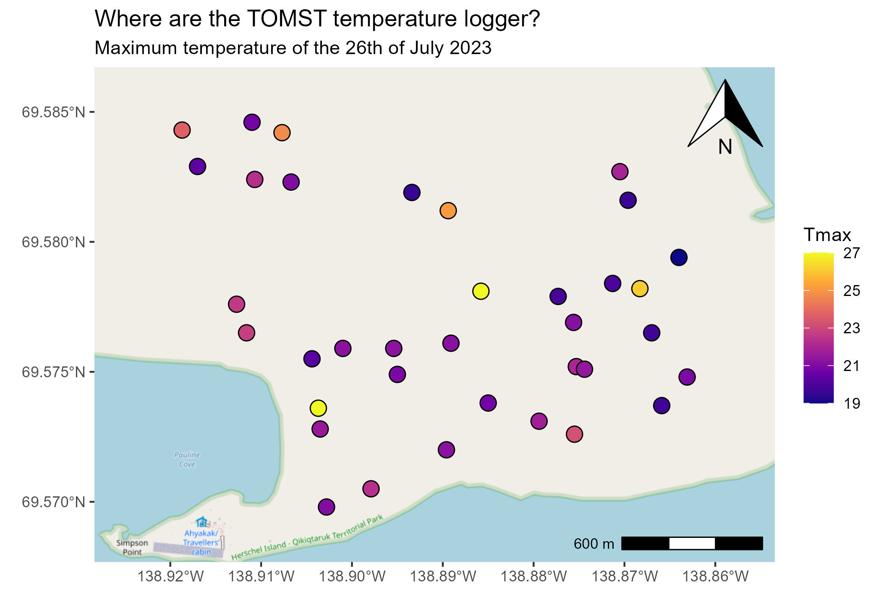

# TOMST-QHI

*This repository stores the raw TOMST logger data collected at the end of each field season on Qikiqtaruk- Herschel Island, Yukon. It also includes the scripts to pre-process the data and sample scripts for how to aggregrate the data for various uses.*

## Description

TOMST are autonomous units which measure air and soil temperature as well as soil moisture using three temperature sensors and one soil moisture sensor. Specifications for the TOMST equipment can be found [here](https://tomst.com/web/en/systems/tms/tms-4/). TOMST01-20 are associated with Phenocams. More details are available in TOMST_metadata.csv

## Data list

The TOMST were initially deployed in July 2022 at 40 sites. TOMST begin collected data from when they are manufactured, so data recorded prior to this date is pre-deployment and should be removed.

Following July 2022, the TOMST have remained deployed in the field and members of Team Shrub download the data from the TOMST each August. Therefore, each 'year' folder doesn't just represent data from that year, but rather the year that the data was downloaded from the TOMST and includes that year's summer field season and all years before it). If a TOMST is lost or damaged before the next download, all data is lost and so previous years downloads are retained to act as a backup. Please see the TOMST Graveyard for details of when TOMST were lost/ damaged and if/when they were replaced.

All data in the "year" folders is stored as raw data from the TOMST. Scripts for pre-processing and data organization are available in the Scripts section below.

*When new raw data is available please add it to an appropriate year folder and ensure it is following the same naming convention as the other folders.*

CSVs in the data folder are prepared data, including: \* 2025_TOMSTdata_preprocessed_daily.csv : 2022-2025 data that has been pre-processed and aggregated to **DAILY** values using *Pre-processing_script_TOMST.R*. Note that max and min are actually the 95th percentile and 5th percentile values. \* 2025_TOMSTdata_preprocessed_monthly.csv : 2022-2025 data that has been pre-processed and aggregated to **MONTHLY** values using *Pre-processing_script_TOMST.R*. Note that max and min are actually the 95th percentile and 5th percentile values. \* TOMST_metadata.csv : Data about the TOMST locations, including lat, long, closest phenocam and more.

### *TOMST Graveyard*

RIP in 2023: 
- TOMST_02 (serial#: 94217233) was lost in the ALD at phenology ridge. It was not redeployed until 2025 (serial#: 96641248)
- TOMST_11 (serial#: 94217225) was located on the spit. It was recovered in June 2023, but lost by August. It has never been redeployed.

RIP in 2024: 
-TOMST_05 (serial#:94217232) was not recovered in August 2024. In 2025, it appears that what was formerly TOMST_34 (serial#: 94217246) was transferred to TOMST_05. Unclear if this was on purpose of by mistake. 
- TOMST_02 and TOMST_11 were still not replaced. No data for 2024.
- On June 13 2024 TOMST_14 (serial#: 94217222) was found broken. The data up to that date is available in the 2024 folder.
  
RIP in 2025: 
- TOMST_02 and TOMST_11 were still not replaced. No data for 2024.
- TOMST_34 (serial#: 94217246) was relabelled as TOMST_05. It is unclear if the physical hardware was moved. No other serial number for TOMST_34 was collected. It was probably not deployed in Fall 2025- Summer2026. 
- In 2025, TOMST_11 (serial#: 94217225) was lost to a retrogressive permafrost thaw slump in summer of 2025. The most recent data is from 2024.
- TOMST_08, TOMST_14, TOMST_27 and TOMST_29 were all not recovered. 

_In August 2025, TOMST_02 and TOMST_29 were replaced with new hardware (TOMST_02: serial#: 96641248, TOMST_29: serial#: 96641245). Note that the script should be updated to cut out the period when these devices were in the factory._

RIP in 2026:
-TOMST_04 (serial#: 94217235) was recovered, but the device was broken and data was undownloadeable. It, alongside TOMST_14 and their associated Phenocams were flooded out. 
-TOMST_07 (serial#: 94217234), TOMST_08 (serial#: unknown), TOMST_14 (serial#:unknown) and TOMST_28 (serial#: 94217241) were all not recovered. 
-TOMST_34's hardware was still being used for TOMST_05. No data collected at the TOMST_34 site. This site is now an ALD. 

_In August 2026, TOMST_04 and TOMST_14 were replaced with new hardware (serial#: unknown-- update in 2027)._

## Scripts

When new raw TOMST data is available it is appropriate to use *Pre-processing_script_TOMST.R* to re-pre-process the data and print new preprocessed files for the most recent year. The *Pre-processing_script_TOMST.R* is clearly annotated such that anyone should be able to understand it.

Once standardized pre-processing is complete, you can clean the data in whichever way makes sense for your project. Example cleaning scripts include:

### Acknowledgments

These data were collected by various members of Team Shrub on Qikiqtaruk- Herschel Island located off the north coast of the Yukon in the Tariuq (Beaufort Sea). Qikiqtaruk lies within the Inuvialuit Settlement Region and is part of Qikiqtaruk Territorial Park, which is co-managed by the Inuvialuit and the Yukon Government. The island holds deep cultural and historical significance for the Inuvialuit and it remains an active and meaningful part of the Inuvialuit homeland. This repo was prepared by Bailey Bingham and Jeremy Borderieux.
